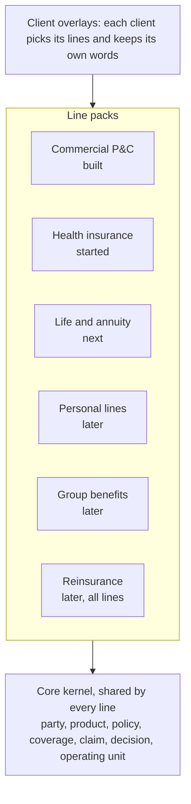
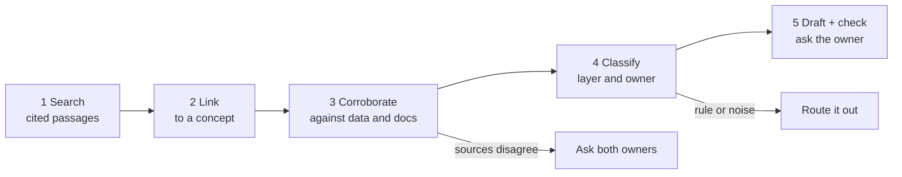
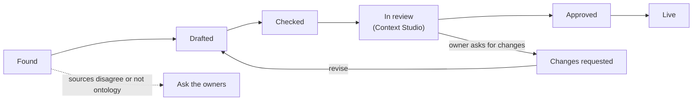
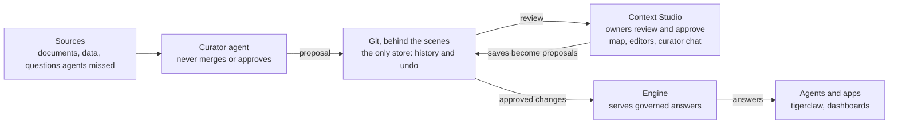
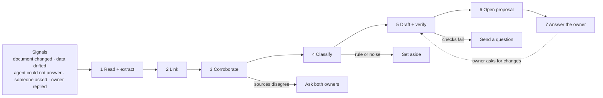
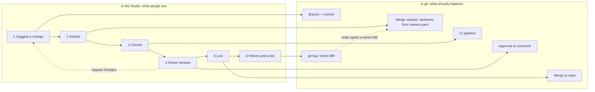
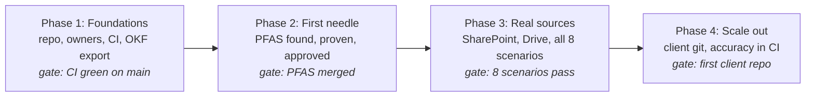

# Tiger Ontology Curator: build spec

> Repo copy of the living spec. The [Claude doc](https://claude.ai/code/artifact/83fa8fad-c725-4034-af3d-a36533f946ed) is where the team comments; when either changes, update the other in the same week.

## Why we are building this

Every company wants AI that gives the right answer. Most get AI that gives *an* answer. The difference is not the model. It is whether the AI knows what the business means: what counts as a claim, which premium goes into a loss ratio, which of three systems to trust.

That knowledge changes every week. It hides in contracts, specs, memos and data nobody reads end to end. Today people keep it current by hand, or not at all.

We are building the Tiger asset that keeps it true. A curator agent reads everything, finds the one line that changed, proves it against the data, and asks the right person to approve. People stay in charge; the agent does the reading.

**Insurance first, and every line of it:** commercial P&C, health insurance, life and annuity, then personal lines, group benefits and reinsurance. It is the hardest version of the problem: many units, many systems, regulators everywhere. Win there and the same curator runs on a bank's risk codes or a retailer's product hierarchy.

**It already works, in miniature.** Five scripts in `examples/curator/` run the whole loop in under a minute:

- find a regulatory needle in 12 documents, and ignore the two decoys;
- confirm it in the data, draft the change, pass every check;
- the owner asks "why?" in chat, sees the quote, and approves.

**Your job:** turn each of those scripts into a real, tested component. The rest of this doc is the map.

**How we build it**

1. People decide. Agents do the reading.
2. Every claim carries its quote and its page.
3. Every needle gets a practice case, so we can prove we find it.
4. Business users never see the plumbing.

## One kernel, every line of business



Every line shares one kernel, so "all claims for this customer" works across P&C, health and life. A carrier that writes several lines simply picks several packs. The curator is the same for every line; only the needles change:

| Line | A typical needle | Where it hides |
| --- | --- | --- |
| Health insurance | Prior-auth decisions now due in 72 hours | A federal rule |
| Health insurance | New drug codes this quarter | A code-set release |
| Life | New mortality table for reserves | An actuarial memo |
| Annuity | Cap cut on an indexed strategy | A rate sheet |
| Annuity | New best-interest questions at sale | A state bulletin |
| Group benefits | Waiting period changed for one employer | An employer contract |

## Purpose and scope

We are building an agent that keeps a company's ontology up to date, starting with insurance. It reads company documents and data, spots what changed, writes it up, and asks the right person to approve. Business users only see proposals and an Approve button in Context Studio. Behind the scenes, git keeps every version, so any change can be undone.

| We are building | Not now |
| --- | --- |
| Git behind the scenes, for history and undo | The agent merging anything. People approve and merge |
| A curator agent that finds and drafts changes | Changes to the engine itself |
| Owners review and approve in Context Studio | Business rules, like underwriting appetite |
| Named owners for each area |  |
| Works with a client's own git later |  |

**Done looks like:** a clause buried on page 41 of a treaty becomes a proposal in the owner's Context Studio inbox within minutes, with the quote, proof from the data, and the right owner asked to approve.

## Needle in a haystack: the scenarios we build for

Important changes hide in one clause, one footnote or one new code in the data. These are the eight insurance cases we build and test for first. Every domain has the same shapes: a buried clause, a new code in the data, two sources that disagree.

| # | Needle | Hides in | The curator |
| --- | --- | --- | --- |
| 1 | Wildfire hours clause: 72 to 168 hours | Page 41 of a treaty endorsement | Updates event rules, lists affected metrics |
| 2 | Paid no longer includes expense | Footnote in an MGA bordereau spec | Fixes the HPG mapping, confirms in the data |
| 3 | Program loss ratio net of commission | An actuarial memo | Client metric override, before and after |
| 4 | New status: suspended, litigation hold | A claims-manual update | Matches SUSPENDED in the data, adds it |
| **5** | **PFAS claims coded separately** | **Page 3 of a state bulletin** | **Adds it to the pack, confirmed by HPG data. The hello-world case** |
| 6 | No habitational risks on the coast | An underwriting guideline | A rule, not the model: routes it out |
| 7 | CFO starts saying "net retained ultimate" | A meeting transcript | Suggests an alias, asks before drafting |
| 8 | Two definitions of "litigated" | Claims manual vs data dictionary | Does not pick one: asks both owners |

Cases 6 to 8 matter as much as 1 to 5: a good curator knows when to hold back.

**How the curator finds a needle**



Every claim keeps its quote and page. We test the curator on a practice set of documents with planted needles and decoys, and track how many it finds and how many it gets wrong.

## How owners review



Every change follows the same steps. Owners only act at **In review**, and only in Context Studio:

| Owner says | Curator does |
| --- | --- |
| "What's waiting for me?" | Lists the proposals in their area |
| "Why do you think this?" | Shows the quote, the page and the data |
| "Only for program business" | Revises the proposal and re-runs the checks |
| "Approve" | Records the approval under the owner's name |

The curator can never approve on its own. Engineers can also review the same change directly in git if they prefer.

## Owners and approvals

Each area has named owners, and only they can approve changes to it. If a change touches two areas, both owners approve.

| Area | Owner | Approves |
| --- | --- | --- |
| Pack concepts | Tiger pack steward | Concepts every client needs |
| Client vocabulary | Client data steward | Names, required fields, extensions |
| Metrics | Actuarial / finance | Metric definitions |
| Unit mappings | Unit data engineer | How a source system maps in |
| Privacy | Compliance | What is sensitive, what agents see |

Owners are listed once, in `owners.yaml`. CI turns that file into git's `CODEOWNERS`, so git and the curator always agree on who owns what.

```yaml
areas:
  metrics:
    paths: [ontology/metrics/, "clients/*/client.yaml#metrics"]
    owners: ["@actuarial-leads"]
    min_approvals: 1
  unit-mappings-hpg:
    paths: [clients/summit_group/units/hpg/]
    owners: ["@hpg-data"]
    min_approvals: 1
```

**An approval is recorded twice:** in git (the owner approves in Context Studio) and in the OKF file (`verified: human:<owner>`). The curator can open and revise proposals, but it can never approve one.

**Engineering note.** If the git host can enforce owner approval, turn it on. If not, CI blocks the merge until the owner has approved.

## How it fits together



The curator only proposes. Owners decide. The engine only ever reads what owners approved, so agents in tigerclaw answer from approved knowledge.

## Context Studio: where people work

People work in **Context Studio**, a web app over the git repo. Every screen reads from git, and every save becomes a proposal, so the Studio keeps no data of its own. tigerclaw embeds the parts it needs: the map, review cards and curator chat.

**[Open the wireframes](https://claude.ai/artifact/15kvEpguiK7RoG2UuvL8YP)**: six screens, plus two flow diagrams for developers. In this repo: [docs/studio/](studio/README.md), with images of every screen and a clickable HTML copy.

| Screen | For | What they do there |
| --- | --- | --- |
| Map | Everyone | See the whole ontology, what connects to what, and what is about to change |
| Inbox | Area owners | Read the quote and the proof, then approve or ask why |
| Concepts | Client stewards | Edit definitions, names and examples |
| Metrics | Actuarial, finance | Change a definition and see the numbers before and after |
| Mappings | Unit data engineers | Map source columns to fields and preview the rows |
| History | Owners, audit | See every change and who approved it; undo is a proposal too |

**For developers:** diagram A shows how the curator turns a signal into a proposal, and when it holds back. Diagram B shows what each Studio button does in git.





**Build order:** the inbox first (phase 2), because nothing goes live without it. The map and concepts come next (phase 3), then metrics and mappings.

### Meeting walkthrough (30 minutes)

1. **Map, 5 min.** The whole ontology on one screen: the kernel in the middle, the P&C pack around it, the client's wording and the source systems at the edge. Amber rings mark changes waiting for approval.
2. **Inbox, 8 min.** Follow PFAS end to end: the bulletin quote, 5 HPG claims as proof, two decoys set aside, the checks green. Ask the curator "why the pack and not just Summit?", then approve.
3. **Concepts, metrics, mappings, 7 min.** Three editors, one rule: saving makes a proposal. On the metric screen, point at the before and after numbers.
4. **History, 3 min.** Undo is a proposal too, approved like any other change.
5. **Diagrams A and B, 7 min.** How the curator decides, and what each button does in git.

**To settle in the meeting:** the Studio as its own app with tigerclaw embedding parts (proposed); the inbox as the first screen; who plays each owner in the pilot.

## Behind the scenes: the git repo

One repo per client. The engine reads the ontology files; agents read the OKF knowledge files. The engine finds the repo through `ICTX_CONTENT_DIR`.

```
insurance-ontology/                 # our git today; a client's own git later
  owners.yaml                       # ownership registry (see Owners and approvals)
  CODEOWNERS                        # generated from owners.yaml by CI; never edited by hand
  .gitlab-ci.yml                    # quality gates (see CI pipeline)
  ontology/
    core/core.yaml                  # L1 kernel            (Tiger)
    lines/commercial_pc.yaml        # L2 line pack         (Tiger)
    metrics/commercial_pc.yaml      # governed metrics     (Tiger + actuarial)
  clients/
    summit_group/
      client.yaml                   # L3 client overlay    (client stewards)
      units/
        ses/mappings.yaml           # L4 unit mapping      (unit engineers)
        hpg/mappings.yaml
        hpg/overlay.yaml
  okf/
    summit_group/                   # OKF bundle: generated structure + human prose/trust
      index.md                      # okf_version: "0.2"
      log.md                        # business-readable change history
      entities/claim-file.md
      metrics/ultimate-loss-ratio.md
      sources/hpg/bdx-claims.md
      proposals/cp-d01b51d4cd.md    # open proposals as draft concepts
  corpus/                           # pointers to enterprise documents the curator reads
    sources.yaml                    # SharePoint / Drive / S3 locations, never the files themselves
```

**Three rules**

1. The ontology files are the source of truth. OKF files are rebuilt from them, except the parts people write.
2. Documents stay where they are. The repo keeps links and the quoted lines that justify a change.
3. Every change comes through a merge request. Nobody pushes to `main`, bots included.

## Knowledge files: our OKF profile v0.1

Knowledge files follow [OKF v0.2](https://github.com/GoogleCloudPlatform/knowledge-catalog/blob/main/okf/SPEC.md): Markdown with a small YAML header, where only `type` is required. We add a few fields of our own; any OKF reader can still read the files.

| File type | One file per | Built from |
| --- | --- | --- |
| Ontology Entity | Concept (Claim File, Policy) | The ontology |
| Value Set | List of codes (Cause of loss) | The ontology |
| Attested Computation | Governed metric | Metric definitions |
| Source Table | Mapped source table | Unit mappings |
| Change Proposal | Open proposal | The curator |

**Who writes which fields.** The generator rewrites its fields on every run and never touches the ones people own.

- **The generator writes:** type, title, canonical, layer, is\_a, relates\_to, attributes, customized, sources.
- **People write:** status, verified, and the sections Business definition, Examples and Decisions.

**Links.** OKF links have no meaning of their own, so each entity also lists `relates_to` (which field points to which concept).

**Evidence.** Every claim from a document gets a footnote with the document, page and line, so a reviewer can open the exact page.

**CI checks** that every file has a `type`, every entity has `canonical` and `layer`, every link points to a real file, and every proposal links its merge request.

## Behind the scenes: talking to git

The curator talks to git through one small interface. Pointing it at a client's own git is a config change, not new code.

```python
class GitBackend(Protocol):
    # repository
    def checkout(self, ref: str = "main") -> Path: ...            # fresh working copy
    def create_branch(self, name: str, base: str = "main") -> None: ...
    def commit(self, paths: list[str], message: str, author: Actor) -> str: ...   # returns sha
    def push(self, branch: str) -> None: ...
    # change requests (merge requests / pull requests)
    def open_change_request(self, branch: str, title: str, body: str,
                            reviewers: list[str], labels: list[str]) -> ChangeRequest: ...
    def update_change_request(self, cr: ChangeRequest, body: str | None = None) -> None: ...
    def comment(self, cr: ChangeRequest, text: str, reply_to: str | None = None) -> None: ...
    def comments(self, cr: ChangeRequest, since: datetime | None = None) -> list[Comment]: ...
    def approvals(self, cr: ChangeRequest) -> list[Approval]: ...  # who approved, when
    def status(self, cr: ChangeRequest) -> CRStatus: ...          # open / merged / closed + CI state
```

| Backend | Used for | When |
| --- | --- | --- |
| `LocalGitBackend` | Offline demos and tests | Now |
| `GitLabBackend` | Our git | Phase 2 |
| `GitHubBackend` | A client's own git | On request |
| `AzureDevOpsBackend` | A client's own git | On request |

**Two kinds of git work, two tools.** Working with files (clone, branch, commit, push) is the same on every host, so it uses plain git through one small wrapper. Reviews (merge requests, approvals, comments, labels) differ by host, so each backend uses that host's SDK: `python-gitlab` for our git, `PyGithub` for GitHub, and the `azure-devops` SDK for Azure DevOps. The rest of the system only sees `GitBackend`.

**Starting out.** SSH access is enough for the first demo: git push options (`git push -o merge_request.create ...`) open a merge request without an API token. Reading comments and approvals needs a project token.

**Tokens** go in `.env` as `GIT_TOKEN`, never in the repo or in chat. The bot user can push branches and open merge requests. It cannot merge or approve.

## Curator agent

The curator is a LangGraph agent with a fixed set of tools. Its job: turn signals into checked proposals, send them to the right owner, and answer questions about them. It drafts and asks; it never decides what the business means.

**Signals it listens to**

| Signal | Comes from |
| --- | --- |
| A document changed | Document stores (treaties, specs, manuals, memos) |
| The data drifted | Nightly checks on each unit's systems |
| An agent could not answer | tigerclaw questions |
| Someone asked | Studio or tigerclaw chat |
| An owner replied | Context Studio reviews |

**Tools**

| Tool | Does |
| --- | --- |
| `search_corpus` | Finds passages, with document and page |
| `extract_claims` | Pulls out codes, definitions, renames, dates |
| `link_to_ontology` | Matches a claim to a concept |
| `corroborate` | Checks it against the data and other docs |
| `classify` | Change, rule or noise; which layer; which owner |
| `draft_change` | Writes the change on a branch |
| `verify` | Runs every check, measures impact |
| `open_change_request` | Sends the proposal to its owner |
| `respond` | Answers questions, revises the draft |
| `explain` | Plain-language evidence for the chat |

**Guardrails**

- It never merges, approves or pushes to `main`. Its token can't.
- One weak source is not enough. It asks the owner first.
- When sources disagree, it asks both owners instead of picking one.
- If the checks fail, it sends a question, not a merge request.
- Every claim has a quote and a page. Claims without one are dropped.
- It batches related changes, so owners are not flooded.

## Behind the scenes: what a proposal looks like in git

Every curator merge request has the same shape, so owners learn it once and CI can check it.

- **Branch:** `curator/<proposal-id>-<slug>`, e.g. `curator/cp-7a1e-hpg-paid-excludes-expense`.
- **Commits:** one per logical change, author `curator-bot`, trailer `Proposal: <id>`.
- **Labels:** `curator`, the area (`area::unit-mappings-hpg`), the kind (`kind::mapping-change`), the confidence (`confidence::high`).
- **Reviewers:** every owner of every area the diff touches, from `owners.yaml`.
- **Scope:** one proposal per merge request; related claims from the same source are batched.

**Description template**

```markdown
## What changes
HPG paid loss will read PAID_TD only; paid expense moves to EXP_PAID_TD (from 2027-01 bordereaux).

## Why (evidence)
- "From January, PAID_TD excludes expenses; see EXP_PAID_TD." HPG bordereau spec v3.2, p.7, footnote 3 [^spec]
- Data: HPG paid loss drops 18% in the January bordereau while EXP_PAID_TD first appears.

## Impact
- Concepts: ClaimFinancialTransaction (HPG mapping)
- Metrics: paid_loss, paid_alae, reported_incurred_loss_alae, loss_alae_ratio, ultimate_loss_ratio
- Before / after at 2026-06-30: HPG paid ALAE $6.9M -> $7.4M; HPG loss & ALAE ratio 57.1% -> 57.8%

## Confidence
High: document and data agree.

## Verification
ictx check: pass | tests: 53/53 | reconciliation: pass | OKF conformance: pass

## Ask
@hpg-data: approve, or reply here or in Context Studio with changes.

[^spec]: corpus://hpg/bordereau-spec-v3.2.pdf#page=7
```

The numbers in the template are illustrative. Real values come from `verify`, which recomputes the affected governed metrics on the branch and on `main` at the same valuation date.

## Behind the scenes: automatic checks

Every merge request, from people or the curator, passes the same gates. A red gate blocks the merge; the curator reads the failure and either fixes its draft or turns it into a question.

| Check | Blocks the merge when |
| --- | --- |
| Resolve and lint | The ontology or a metric breaks |
| Tests | Any engine test fails |
| Reconciliation | Totals stop matching the source |
| Knowledge files | An OKF file is malformed |
| Owners | The right owner has not approved |
| Evidence | A claim has no quote or page |
| Impact | Never blocks; posts before/after numbers |

`ictx reconcile`, `ictx okf check`, `ictx owners check`, `ictx proposals check` and `ictx impact` are new commands; the rest exist today.

## How we develop: ten rules

These are the rules that got the hello world working. Hold every change to them.

1. **Product, not demo.** If it only works on the laptop that built it, it isn't done. Every feature ships with a test and runs on a reference client.
2. **Start from the hello world.** Each component grows out of its example script. The script stays in the repo and keeps passing.
3. **The answer key is the spec.** Every needle we plant has an answer key. A change that finds fewer needles, or stops holding back on a decoy, is a regression.
4. **Kernel, pack or client, in that order of caution.** A concept goes in the kernel only if every line needs it, in a line pack if every client in that line needs it, and otherwise in the client overlay. When in doubt, go lower.
5. **Never move an IRI.** Overlays add and restrict; they never rename or redefine. Client dashboards and agents depend on base concepts staying put.
6. **Governed beats clever.** Agents query governed views and metrics, never raw tables. If an answer needs a new metric, add the metric, not a longer prompt.
7. **Show the work.** Every answer carries its trace: which concept, which metric, which mapping. If a layer helped, the user can see it helped.
8. **Evidence or it didn't happen.** Every proposal cites the page it came from and is checked by building the ontology with the change applied. The curator drafts; owners decide.
9. **Small and reversible.** One proposal, one change. Anything merged can be reverted without side effects.
10. **Safe by default.** Synthetic data and fictional names only. Secrets live in `.env`, never in git. Business users never see git, and the curator never merges.

## Hello-world examples

Five small scripts walk one needle through the whole loop. They live in `tiger-context-engineering/examples/curator/` and run offline against a local git repo. Each one is the starting point for a real component.

**The needle:** scenario 5, PFAS. The practice set has 12 documents. One sentence on page 3 of a state bulletin says PFAS claims must be coded separately. Two decoys also mention PFAS: an underwriting exclusion (a rule, not a concept) and a news article. HPG's data already has 5 claims coded `PFAS` that the ontology doesn't know.

| Script | What you see |
| --- | --- |
| `01_find_the_needle.py` | The needle found, two decoys set aside |
| `02_corroborate.py` | The data agrees; layer and owner chosen |
| `03_draft_and_verify.py` | The change on a branch, every check green |
| `04_open_change_request.py` | The proposal, with its evidence |
| `05_curator_chat.py` | The owner asks why, then approves |

**Run them**

```bash
git clone https://github.com/kirankaipa-eng/tiger-context-engineering.git
cd tiger-context-engineering
uv sync --extra agent --group dev
uv run python examples/curator/01_find_the_needle.py
uv run python examples/curator/02_corroborate.py
uv run python examples/curator/03_draft_and_verify.py
uv run python examples/curator/04_open_change_request.py            # local backend
uv run python examples/curator/04_open_change_request.py --remote <git-url>   # dry run
uv run python examples/curator/05_curator_chat.py                   # needs API_KEY / API_BASE_URL / CHAT_MODEL
```

Scripts 1 to 4 need no LLM, so they give the same result every time and double as tests. Script 5 uses the Tiger AI gateway.

## Roadmap



Phase 2 is the demo: one real needle, found, proven and approved by its owner. Each phase starts from the hello-world file for that step.

| Workstream | Starts from | Phase |
| --- | --- | --- |
| Content repo, owners, CI | Repo layout, CI gates | 1 |
| OKF export | OKF profile | 1 |
| Finding needles | `01_find_the_needle.py`, `02_corroborate.py` | 2 |
| Drafting and checking | `03_draft_and_verify.py` | 2 |
| Git backend | `04_open_change_request.py` | 2 |
| Context Studio: inbox and curator chat | `05_curator_chat.py` | 3 |
| Document connectors | `corpus/sources.yaml` | 3 |

**Line packs run alongside.** Each pack is its own workstream on the same kernel, with its own needles and a reference client:

| Line pack | What it needs | Phase |
| --- | --- | --- |
| Health insurance | Deepen: Medicare Advantage, pharmacy, risk adjustment | 2 |
| Life and annuity | New pack, metrics, sample data | 2 |
| Personal lines | New pack | 3 |
| Group benefits | New pack | 4 |
| Reinsurance | Split out of P&C, shared by all lines | 4 |

## Open questions

- [ ] Which git repo do we use, and can it enforce owner approvals?
- [ ] Who owns each area? Names for pack, client, metrics, unit mappings and privacy.
- [ ] Which document stores does the curator read first: SharePoint, Google Drive, or both?
- [ ] Can Context Studio record approvals under the owner's own identity (SSO)?
- [ ] How many open curator MRs per owner per week is acceptable?
- [ ] After P&C, which line leads for the second client: health or life and annuity?
