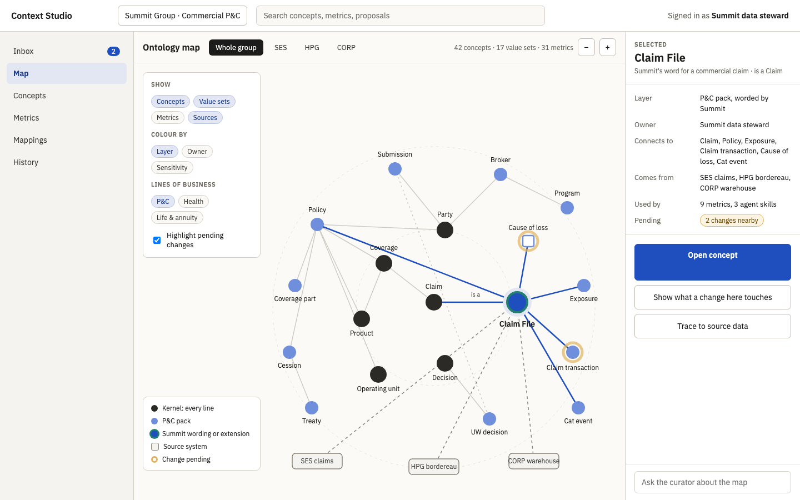
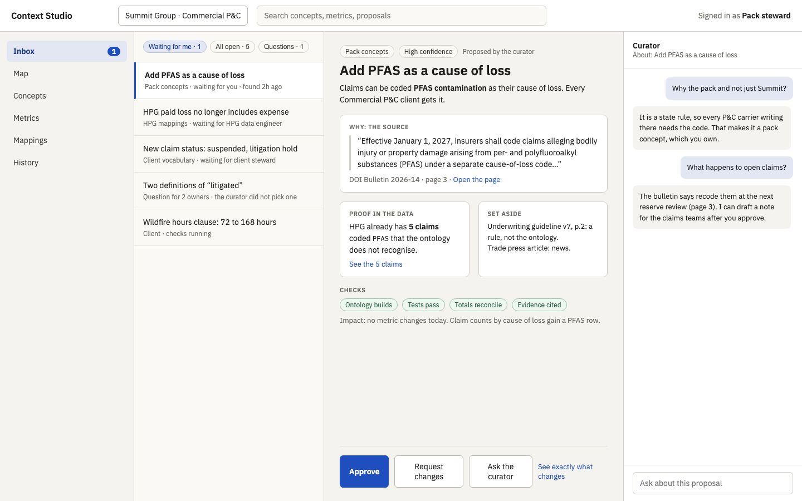
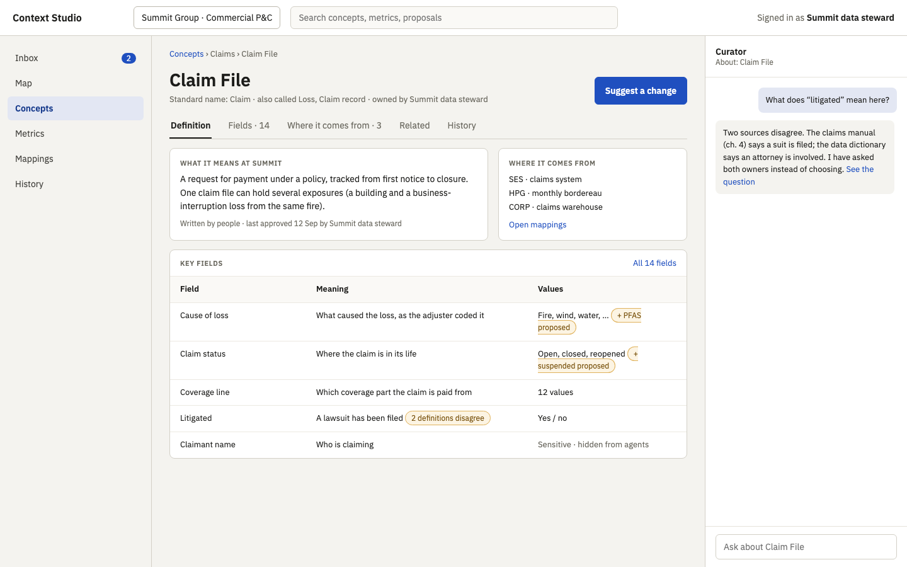
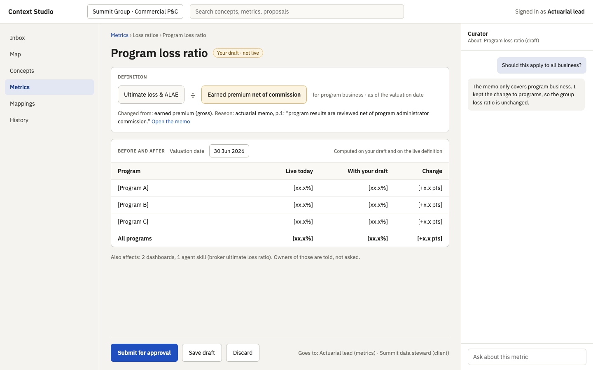
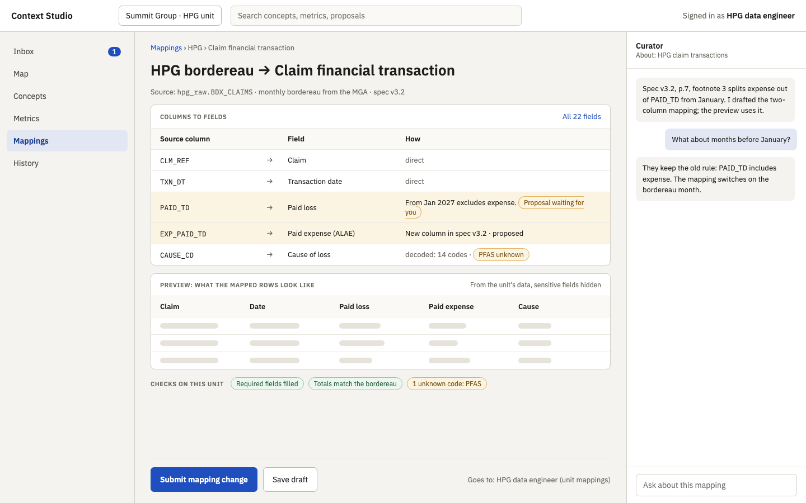
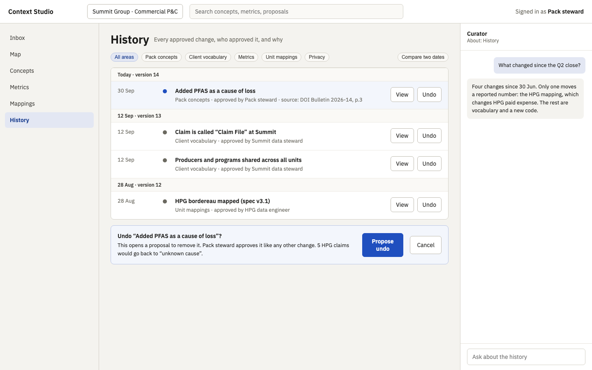
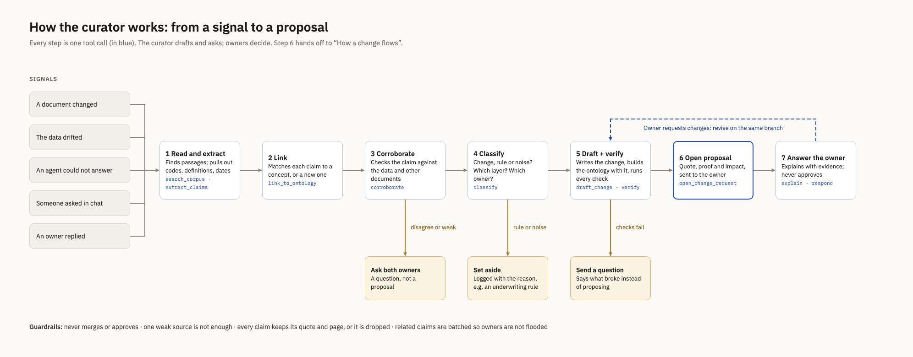
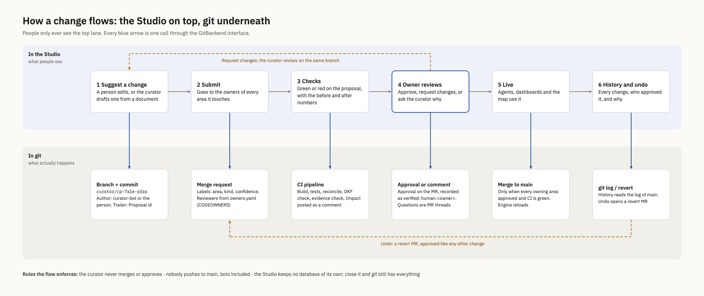

# Context Studio wireframes

Context Studio is where people work on the ontology. It is a web app over the git
repo: every screen reads from git and every save becomes a proposal, so the Studio
keeps no data of its own. Business users never see git.

- **Live canvas** (comment there): https://claude.ai/artifact/15kvEpguiK7RoG2UuvL8YP
- **Clickable copy**: open [`html/inbox.html`](html/inbox.html) in a browser; the sidebar links work.
- **Spec**: [../CURATOR_SPEC.md](../CURATOR_SPEC.md), section "Context Studio".

These are wireframes, not the final design. Numbers in square brackets are
placeholders; real values come from the `verify` step.

## Meeting walkthrough (30 minutes)

1. **Map, 5 min.** The whole ontology on one screen.
2. **Inbox, 8 min.** Follow PFAS end to end, then approve.
3. **Concepts, metrics, mappings, 7 min.** Three editors, one rule: saving makes a proposal.
4. **History, 3 min.** Undo is a proposal too.
5. **Diagrams A and B, 7 min.** How the curator decides, and what each button does in git.

To settle: the Studio as its own app with tigerclaw embedding parts (proposed); the
inbox as the first screen; who plays each owner in the pilot.

## 1. Map (everyone)

The kernel in the middle, the P&C pack around it, the client's wording and the
source systems at the edge. Amber rings mark changes waiting for approval.

## 2. Inbox (area owners)

The PFAS proposal: the bulletin quote, 5 HPG claims as proof, two decoys set aside,
checks green. The owner can approve, request changes, or ask the curator why.

## 3. Concept (client stewards)

Definitions written by people, where the concept comes from in each unit, and which
fields have changes pending. "Suggest a change" makes a proposal.

## 4. Metric (actuarial, finance)

A draft definition, the reason with its source, and the numbers before and after at
the valuation date.

## 5. Mapping (unit data engineers)

Source columns to fields, a preview of the mapped rows, and the unit's checks.

## 6. History and undo (owners, audit)

Every approved change, who approved it and why. Undo opens a proposal.

## For developers

### A. How the curator works

### B. How a change flows: the Studio on top, git underneath

## Updating these files

The canvas is the source. After changing it, re-export each artboard to `html/` and
re-render `png/` (headless Chromium, window size = the artboard size).
